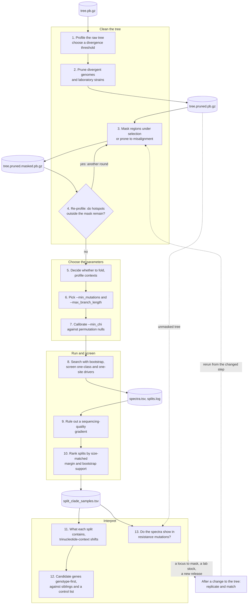

# How to tune spectrumSplits on a new tree

This guide walks a new tree through the workflow, one step at a time. For
each step it gives the commands, says which section of which output to read,
and says what to decide from it. Each step ends with what that decision was
on the *M. tuberculosis* (MTBC) tree the workflow was developed on, and links
to the step's section in [METHODS.md](METHODS.md), which explains why the
step works the way it does and goes through the MTBC results in full.
[SCRIPTS.md](SCRIPTS.md) has every script's options and output columns.

The MTBC values are examples, not defaults. Another species or another
sampling scheme will give different numbers, and sometimes different
decisions; the point of each step is to read them off your own tree.

## Overview



Steps 3 and 4 repeat until the remaining hotspots are only flanks of loci
already masked. Steps 5 to 12 run on the masked tree. Step 13 goes back to
the pruned tree before masking, because the mask removed the resistance
mutations it looks for.

## Contents

- [Overview](#overview)
- [Before you start](#before-you-start)
- [Step 1. Profile the raw tree](#step-1-profile-the-raw-tree)
- [Step 2. Prune samples with implausible divergence](#step-2-prune-samples-with-implausible-divergence)
- [Step 3. Build and apply a region mask](#step-3-build-and-apply-a-region-mask)
- [Step 4. Re-profile, and check what the mask bought](#step-4-re-profile-and-check-what-the-mask-bought)
- [Step 5. Decide whether to fold](#step-5-decide-whether-to-fold)
- [Step 6. Pick `--min_mutations` and `--max_branch_length`](#step-6-pick---min_mutations-and---max_branch_length)
- [Step 7. Calibrate `--min_chi`](#step-7-calibrate---min_chi)
- [Step 8. Run the search with bootstrap, and check where it saturates](#step-8-run-the-search-with-bootstrap-and-check-where-it-saturates)
- [Step 9. Check the splits against sequencing quality](#step-9-check-the-splits-against-sequencing-quality)
- [Step 10. Rank the splits before interpreting them](#step-10-rank-the-splits-before-interpreting-them)
- [Step 11. Check what each split contains before claiming a mechanism](#step-11-check-what-each-split-contains-before-claiming-a-mechanism)
- [Step 12. Test a candidate mechanism genotype-first](#step-12-test-a-candidate-mechanism-genotype-first)
- [Step 13. Ask whether the splits' spectra show in their resistance mutations](#step-13-ask-whether-the-splits-spectra-show-in-their-resistance-mutations)
- [After a change to the tree: replicate and match](#after-a-change-to-the-tree-replicate-and-match)

## Before you start

**What you need.**

- The tree as an UShER mutation-annotated tree, `tree.pb.gz` below.
- The reference sequence (`NC_012345.1.fna` below) and its annotation, GFF3
  or GenBank (`NC_012345.1.gff3.gz`), in the tree's coordinates.
- `matUtils`, `spectrumSplits.py` and the scripts in this directory.
- A Python environment with `bte`, numpy and matplotlib. Most scripts need
  only `bte`; [SCRIPTS.md](SCRIPTS.md) lists what each needs.
- Two gene lists for the mask, loci under selection (`resistance_genes.txt`)
  and loci that align badly (`alignment_loci.txt`), and a list of candidate
  genes for step 12 (`repair_genes.txt`). The MTBC versions are described in
  [SCRIPTS.md](SCRIPTS.md#gene-lists); use them as templates.

The file names below are generic. Every command is shown with the MTBC
settings filled in wherever a value had to be chosen, and the step that
chose it says how.

**Know how your tree was rooted.** Several steps reconstruct genomes down
the tree from the reference, so the FASTA must be the *root's* genome. If the
tree was rerooted, that is the rerooted reference, not the published
assembly. The MTBC tree was rerooted, and its root genome is
`modified_NC_000962.3.fa`. Rooting also affects how far you can trust
anything near the root ([METHODS.md](METHODS.md#know-how-your-tree-was-rooted)).

**Node IDs change whenever the tree does.** `matUtils` numbers nodes when it
reads a tree, and pruning or masking renumbers them. To follow a clade
across such a change, save its samples *before* overwriting the old tree:

```
matUtils extract -i old.pb.gz -I node_5289 -u node_5289_samples.txt
matUtils extract -i new.pb.gz -s node_5289_samples.txt -U -u found_samples.txt
```

If `found_samples.txt` matches the original list, the clade survived intact
([METHODS.md](METHODS.md#node-ids-are-not-stable-across-trees) has more).
Writing each modified tree to a new file name keeps the old one available.

**Keep every report.** Each step's decision is read off a report, and later
steps refer back to them.

## Step 1. Profile the raw tree

**Run:**

```
profile_tree.py --input_tree tree.pb.gz > profile_raw.txt
```

**Read** the MUTATIONS:TIPS RATIO section of `profile_raw.txt`. It gives the
distribution of mutations per tip across subtrees (mean, median, p90, p99,
p99.9, max) and the automatic threshold the prune script would use (mean +
2 SD), with how many nodes that would catch.

**Decide** the divergence threshold for step 2. Choose a value above the
bulk of the distribution, aimed only at the extreme tail, rather than the
automatic one. If the median is small and p90 already large, the
distribution is broad, and mean + 2 SD would cut into ordinary clades.

**On the MTBC tree:** median 7, p90 54, p99.9 192, max 909. The automatic
71.7 would have caught 10,930 nodes, 5% of the tree. The threshold chosen was
**250**. [Methods for step 1.](METHODS.md#step-1-profile-the-raw-tree)

## Step 2. Prune samples with implausible divergence

**Run** the divergence prune with step 1's threshold, keeping stdout: it is
the only record of what was removed.

```
qc/prune_mutation_sample_ratio.py --input_tree tree.pb.gz \
    --threshold 250 --output_tree tree.pruned.pb.gz > pruned_report.txt
```

**Prune laboratory strains in the same step**, if you know of any: vaccine
strains, lab-adapted stocks, experimental-evolution lines. Pruning later
renumbers every node and means redoing everything from the mask on. Build the
list from the clade labels, with a pattern you keep alongside the run:

```
matUtils summary -i tree.pb.gz --sample-clades clades_raw.txt
awk -F'\t' '$2 ~ /BCG/ {print $1}' clades_raw.txt > lab_samples.txt
matUtils extract -i tree.pruned.pb.gz -s lab_samples.txt --prune \
    -o tree.pruned.nolab.pb.gz
mv tree.pruned.nolab.pb.gz tree.pruned.pb.gz
```

`--prune` removes the listed samples; without it the same command keeps
*only* them. So check the result with `matUtils summary`: the sample count
should have fallen by the number of lab samples the divergence prune had not
already removed. Look through the clade labels for anything else naming a
lab or vaccine strain, since an unlabelled lab stock stays in.

**Check what the divergence prune removed, by clade:**

```
matUtils summary -i tree.pb.gz -s samples_raw.txt
prune_clade_check.py --samples samples_raw.txt --clades clades_raw.txt \
    --prune_report pruned_report.txt --threshold 250 \
    --exclude ReconstructedAncestor --input_tree tree.pb.gz > prune_check.md
```

`--exclude` names placeholder samples to leave out of the counts; the MTBC
tree has one, `ReconstructedAncestor`, from its rerooting. Another tree will
have its own, or none.

**Read** `prune_check.md`:

- **Section 1, removal rate by clade.** Removals spread across unrelated
  clades at roughly the overall rate mean the filter removed bad genomes.
  Removals concentrated in basal clades, or a whole small clade removed at
  once, mean it removed biology.
- **Section 3, prunings at internal nodes.** A whole subtree removed because
  of a long *stem* (`stem` large, tip terminals short) was removed as a
  clade, not as individual bad genomes. Near the root, stem lengths are set by
  where the root was placed.
- **Sections 4 and 5, where the pruned and unlabelled samples sit.** Each run
  of unlabelled samples should sit between named lineages. A run below the
  basal-most named lineage, or flanked by nothing, could be an outgroup and
  needs a look.

**Decide** whether to keep the threshold. Raise it if the prune took whole
small clades or concentrated in basal ones; keep it if it took scattered
outliers.

**On the MTBC tree:** the prune removed 60 samples, and the lab-strain
pattern 336 BCG genomes (128,918 samples left). Lineage 8's three genomes
went on an 863-mutation stem, a consequence of the rerooting, but three
samples could never clear step 6's `--min_mutations`, so it cost nothing. The
unlabelled samples sat inside named lineage 4 sublineages: an annotation
gap, not an outgroup. The threshold was kept.
[Methods for step 2.](METHODS.md#step-2-prune-samples-with-implausible-divergence)

## Step 3. Build and apply a region mask

**Check the gene lists first.** A name the annotation spells differently is
skipped with only a NOT FOUND line, and a name two genes share masks both:

```
check_gene_names.py --names resistance_genes.txt \
    --annotation NC_012345.1.gff3.gz
check_gene_names.py --names alignment_loci.txt \
    --annotation NC_012345.1.gff3.gz
```

Read the **TO FIX** section, use its suggestions (a near spelling, or the
locus tag of a gene the annotation names only by tag), and rerun until every
entry resolves to one locus.

**Build the mask and apply it:**

```
annotate_sites.py --annotation NC_012345.1.gff3.gz \
    --regions resistance_genes.txt --promoter_flank 200 \
    --mask_bed selection_loci.bed --mask_positions selection_pos.txt

annotate_sites.py --annotation NC_012345.1.gff3.gz \
    --regions alignment_loci.txt --mask_pattern '^(PE|PPE|esx)' \
    --mask_product_pattern '(?i)(transposase|integrase|insertion element|^maturase$)' \
    --mask_pad 150 \
    --mask_bed alignment_loci.bed --mask_positions alignment_pos.txt

sort -un selection_pos.txt alignment_pos.txt \
    | awk '{ print "N" $1 "N" }' > matUtils_mask.txt

matUtils mask -i tree.pruned.pb.gz -m matUtils_mask.txt \
    -o tree.pruned.masked.pb.gz
```

The two `annotate_sites.py` passes widen differently: upstream only, for
promoter mutations at selected loci, and on both sides, for artifacts that
spill past a feature's edges. The name and product patterns are the MTBC
tree's paralogous families and mobile elements; write your own from your
species' biology. `matUtils mask` traverses the tree once per masked
position, so expect it to take hours on a large tree.

**Read** `annotate_sites.py`'s stderr for how many names resolved, any NOT
FOUND, and the bases masked.

**Masking comes in rounds.** You can't write the final mask in one go,
because you can't list artifacts until you have seen which sites recur.
After this step, step 4 re-profiles the masked tree and tells you whether to
add to the lists and come back here. Some sites will turn up one or two at a
time later, from step 4's flank check or step 7's hotspot check. Add those
to the build before the `sort -un`, with their intervals in the BED file, so
that step 4's `--near_mask` agrees with the mask:

```
printf '2544936\n2544938\n' >> alignment_pos.txt
printf 'NC_000962.3\t2544935\t2544936\nNC_000962.3\t2544937\t2544938\n' \
    >> alignment_loci.bed
```

`annotate_sites.py` rewrites both files, so append such lines again after
any rerun of it. Keep them with the commands, since they are specific to the
reference.

**On the MTBC tree:** four rounds, the commands above being round 3 and the
two hand-added `lppN` sites round 4. The final mask is 506,765 bp, 11.5% of
the genome. [Methods for step 3](METHODS.md#step-3-build-and-apply-a-region-mask);
what each round added is in the
[record of the four rounds](METHODS.md#record-the-four-rounds-of-tree-modification).

## Step 4. Re-profile, and check what the mask bought

**Run:**

```
profile_tree.py --input_tree tree.pruned.masked.pb.gz \
    --reference NC_012345.1.fna --annotation NC_012345.1.gff3.gz \
    --no_context > profile_masked.txt

annotate_sites.py --annotation NC_012345.1.gff3.gz --reference NC_012345.1.fna \
    --from_profile profile_masked.txt --output surviving_sites.tsv \
    --near_mask selection_loci.bed,alignment_loci.bed
```

**Read**, comparing with the previous round's profile:

- **`profile_masked.txt`, the recurrence figures:** the worst single site
  and the top 20 sites' share. These, not the total mutation count, are what
  the mask is for: recurrent sites break the search's independence
  assumption.
- **`profile_masked.txt`, GLOBAL SPECTRUM:** the folded class proportions.
  A mask that removes artifacts moves them by about 0.001 per round. A
  mask that moves a class by a percent is deleting signal.
- **`surviving_sites.tsv`:** what the top surviving sites are (gene, context,
  amino-acid change). Watch for a site where every possible change is
  synonymous, or a third codon position recurring hundreds of times:
  selection can't produce that, so it is a mapping artifact, usually a
  paralogous family.
- **The `mask_gap` column and the per-interval summary on stderr:** sites
  just outside an interval you already masked, how many mutations they hold,
  and how far the interval would have to widen to cover them.

**Decide** whether to run another round of step 3:

- Flank sites at many unrelated masked loci: widen `--mask_pad`.
- Flank sites clustered at one or two loci: extend those loci by hand, as
  positions added in step 3.
- Top sites still in resistance loci: widen `resistance_genes.txt`.
- New artifact-looking loci: add them to `alignment_loci.txt`.
- **Stop** when the top surviving sites are flanks of loci you have already
  masked and the folded spectrum has stopped moving. Each round costs hours,
  so don't chase a cluster round after round.

Node IDs changed when the tree was masked, so compare clades between the two
profiles by their samples, not their IDs.

**On the MTBC tree:** the worst site fell from 6,102 to 225 mutations and
the top 20 sites' share from 1.24% to 0.12%, while the folded spectrum moved
by about 0.001 per round. [Methods for step 4.](METHODS.md#step-4-re-profile-and-check-what-the-mask-bought)

## Step 5. Decide whether to fold

**Read** the FOLD TEST at the end of the STRAND ASYMMETRY section of
`profile_masked.txt`. It ends in a verdict line:

- `Verdict: fold.` Fold.
- `Verdict: consider NOT folding.` One pair's forward-strand effect varies
  between clades (chi2/df at or above `--fold_max_dispersion`, or one
  clade's |z| at or above `--fold_max_z`), and the report names the clade.
  For a double-stranded genome, look at that clade's reference and alignment
  for an artifact before unfolding. A single-stranded genome is the case
  where not folding is expected.

Don't decide from the global spectrum's complementary pairs (C>T against G>A
and so on). Strand effects cancel there, so near-equal pairs prove nothing.
Decide on the masked tree, not earlier: artifacts the mask removes can make
the test fire.

**Decide** `--fold`, and pass the same choice to every later script that
takes it: `spectrumSplits.py`, `permutation_null.py`,
`branch_class_spectra.py`, `split_contexts.py`, `gene_hit_contrasts.py`, and
`profile_tree.py` below.

**Then profile the trinucleotide contexts**, which steps 11 and 12 use:

```
profile_tree.py --input_tree tree.pruned.masked.pb.gz --fold \
    --reference NC_012345.1.fna --annotation NC_012345.1.gff3.gz \
    --mask selection_loci.bed,alignment_loci.bed \
    --context_table context.tsv > profile_context.txt
```

Leave out `--fold` if you decided not to fold: the context section then
reports the 192 forward-strand classes instead of the 96 folded ones. Give
`--mask` the BEDs the tree was masked with. In the CONTEXT SPECTRUM section,
check four things:

- **The disagreement count** ("own reference base disagrees with the
  reconstructed parent base") should be near zero. Above 1% the report warns
  that the FASTA is not the root's genome, and every context is suspect.
- **The unknown and doublet counts** are what the context analysis can't see.
- **Hotspot contexts:** contexts where a single site carries 20% or more of
  the count stand for that site, not for a sequence context.
- **The count floors** say how many mutations a context test needs.

If `--fold` disagrees with the FOLD TEST verdict, a note under the verdict
says so.

**On the MTBC tree:** the verdict was fold (largest chi2/df 1.67, largest
|z| 3.3). On the raw and the unmasked trees, the same test had said
"consider NOT folding", which the mask resolved. 99.5% of SNVs got a
context, with no disagreements. [Methods for step 5.](METHODS.md#step-5-decide-whether-to-fold)

## Step 6. Pick `--min_mutations` and `--max_branch_length`

**Read** `profile_masked.txt`:

- **The rarest-class floor:** the smallest `--min_mutations` that keeps
  expected cell counts at 5 or more, for 12 types and for the folded
  classes. Use the one for your fold decision.
- **The eligible-candidate table:** for each `--min_mutations`, how many
  nodes are eligible and the smallest eligible subtree's tip count. A small
  subtree that reaches the threshold is running far more mutations per tip
  than the tree as a whole, which makes it a divergence outlier, not a
  clade.
- **The branch-cap table:** for each cap, how many branches and what share
  of mutations it would exclude.

**Decide:**

- **`--min_mutations`:** above the floor, and high enough that the smallest
  eligible subtree is a real clade, while still leaving many candidates.
- **`--max_branch_length`:** if the cap table has a knee, cap there. If the
  distribution is broad, with no knee, cap only the absurd branches: any
  lower cap removes real divergence.

**On the MTBC tree:** folded floor 325. At 2,500 the smallest eligible
subtree was 17 tips at 147 mutations per tip, against 22 tree-wide. **10,000**
left 777 candidates with a 130-tip minimum. There was no knee in the cap
table, and a cap of **250** removed 14 branches, 0.19% of mutations.
[Methods for step 6.](METHODS.md#step-6-pick---min_mutations-and---max_branch_length)

## Step 7. Calibrate `--min_chi`

**Run**, with step 5's `--fold` and step 6's values:

```
permutation_null.py --input_tree tree.pruned.masked.pb.gz --fold \
    --min_mutations 10000 --max_branch_length 250 \
    --replicates 100 --seed 1 --nthreads 8 \
    --annotation NC_012345.1.gff3.gz --reference NC_012345.1.fna \
    > null_report.txt
```

It runs two permutation nulls and writes `null_types.tsv` and
`null_sites_cascade.tsv`; step 10 reads the second.

**Read `null_report.txt` from the end:**

1. **HOTSPOT CHECK first.** `Verdict: no hotspot.` means carry on.
   `Verdict: HOTSPOT at node_N` means one clade is setting the threshold. The
   section lists that clade's most recurrent sites and prints an
   `annotate_sites.py` command for them. If they look like an artifact (a
   pair of sites flipping back and forth, say), mask them, both on the
   current tree and in step 3's build, then rerun step 4's profile and this
   step:

   ```
   printf 'N2544936N\nN2544938N\n' > extra_mask.txt
   matUtils mask -i tree.pruned.masked.pb.gz -m extra_mask.txt \
       -o tree.pruned.masked.new.pb.gz
   mv tree.pruned.masked.new.pb.gz tree.pruned.masked.pb.gz
   ```

2. **PERMUTATION NULL SUMMARY.** The `sites` row is the one to calibrate
   against. Its p95 and the "Recommended" `--min_chi` (2x that p95) are the
   conservative whole-tree threshold. The gap between `sites` and `types`
   is what residual recurrent sites cost: weigh another round of masking
   against it.
3. **NULL CEILING BY SUBTREE SIZE.** Below the table, "Lowest --min_chi that
   clears the whole-tree null" is the least a split of the whole tree must
   beat. The last column is that threshold's margin over each size bin's
   ceiling.
4. **OBSERVED SPLITS AGAINST A SIZE-MATCHED NULL.** `rejected` marks a real
   split the recommended `--min_chi` would turn away although it clears its
   own size's null by 2x or more; `within null` marks one it would accept
   although it doesn't clear its null. `--flag_min_chi` checks a different
   value.

**Decide** `--min_chi`. Chance chi-squared shrinks with subtree size, so a
threshold set at the root is too strict for deep splits. The approach that
worked: take the lowest value that clears the whole-tree null, provided
section 3 shows it about 2x above the ceilings of the smaller bins. Step 10
then judges every accepted split against the null for its own size. If
section 3 shows less than that, prefer the recommended value.

**On the MTBC tree:** the first run flagged a hotspot, two `lppN` sites, and
masking them was round 4. After that, the recommended `--min_chi` was 53 and
the lowest whole-tree-clearing value **30**, which gave about 2x over every
bin below 700k mutations. 30 was used.
[Methods for step 7.](METHODS.md#step-7-calibrate---min_chi)

## Step 8. Run the search with bootstrap, and check where it saturates

**Run** the search, with every value settled so far:

```
spectrumSplits.py --input_tree tree.pruned.masked.pb.gz --fold \
    --min_chi 30 --min_mutations 10000 --max_branch_length 250 \
    --bootstrap_splits 100 --nthreads 8 --output_spectrum spectra.tsv \
    2> splits.log
```

**Check saturation while it runs.** The ordinary search finishes first,
writing a `New split found at node_N with x2 X` line to `splits.log` for each
accepted split. Then a `Bootstrapping splits with 100 replicates` line
appears, and the replicates, the slow part, begin. Read the accepted
chi-squared values above that line:

- If they stop well above `--min_chi`, the run found its own ceiling.
- If they are still arriving just above it, the threshold is deciding what
  is found.

If the threshold has to change, kill the run and restart: you lose only the
replicates already started. Each replicate writes a
`bootstrap_N_splits_output.tsv` in the current directory.

**Then read the results:**

```
split_drivers.py --spectra spectra.tsv --splits_log splits.log \
    --bootstrap bootstrap_*_splits_output.tsv \
    --input_tree tree.pruned.masked.pb.gz --max_branch_length 250 \
    --annotation NC_012345.1.gff3.gz --reference NC_012345.1.fna \
    --highlight repair_genes.txt --mask selection_loci.bed,alignment_loci.bed \
    > split_drivers.txt
```

**Read** `split_drivers.txt`:

- **Any warning on stderr** that a residual total differs from
  `spectra.tsv` means the tree or `--max_branch_length` is not the one the
  search used.
- **SPLIT DRIVERS:** the `verdict` column. `interpret` passed all three
  screens. `one class` means one mutation class carries 80% of the split's
  chi-squared, `one site` that one site carries half of it, and
  `weak support` that fewer than half the bootstrap replicates found it.
  The first two usually mean an artifact; annotate the `site` column's
  position as step 4 did.
- **GENE NAME CHECK:** fix anything under "To fix" in the `--highlight` list
  and rerun.
- **DEFINING-BRANCH ANNOTATION:** which `interpret` splits' defining branches
  hit a highlighted gene, and which branches were too long to annotate.
- **BRANCH HITS:** read the "by chance" column before anything else. It is
  how many of the tests made would reach that P by chance. Near or above 1,
  the result is what chance gives.

**Then check each notable split's lineage** before reading a mechanism into
a hit on its branch:

```
matUtils summary -i tree.pruned.masked.pb.gz --sample-clades clades.txt
matUtils extract -i tree.pruned.masked.pb.gz -I node_N -u node_N_samples.txt
grep -Fwf node_N_samples.txt clades.txt | cut -f2 | sort | uniq -c | sort -nr
```

A hit on a lineage's defining branch is a property of that lineage. It can't
be separated from everything else that defines it; step 12 tests genes in a
way that can.

**On the MTBC tree:** the accepted chi-squared values ran from 17,809.5 down
to 31.0, still arriving at the bar, but 30 was already as low as the null
allowed. 66 splits were accepted, 61 `interpret`. No branch hit beat chance
except a `polA` pair on lineage 2's branch (0.74 by chance), which needs
checking in the reads.
[Methods for step 8.](METHODS.md#step-8-run-the-search-with-bootstrap-and-check-where-it-saturates)

## Step 9. Check the splits against sequencing quality

**Run**, with the search's `--fold` and `--max_branch_length`:

```
branch_class_spectra.py --input_tree tree.pruned.masked.pb.gz \
    --spectra spectra.tsv --fold --max_branch_length 250 \
    --output branch_class.tsv > branch_class_summary.txt
```

**Read** `branch_class_summary.txt`:

- **"THE TEST":** each class's correlation with divergence (mutations per
  tip) across splits, on internal branches and on terminal branches.
  Internal branches can't carry one genome's errors.
  - If the internal correlations match the terminal ones, the spectra track
    lineage.
  - If they are strong on terminal branches and fade on internal ones, the
    splits are tracking sequencing quality.
- **The whole-tree spectrum by branch class:** the ratio column says whether
  terminal branches carry a different spectrum.
- **The per-split table:** a large internal-versus-terminal chi-squared is
  expected on any tree. Wide variation in it between splits says the quality
  gradient is uneven.

**Decide** whether the splits can be read as biology. If quality explains
them, find the clades responsible before going on.

**On the MTBC tree:** the correlations were the same on both branch classes
(`CT|GA` 0.580 internal against 0.565 terminal), so the quality explanation
was ruled out. [Methods for step 9.](METHODS.md#step-9-check-the-splits-against-sequencing-quality)

## Step 10. Rank the splits before interpreting them

**Run** two loops to assemble the inputs, before anything renumbers the
tree's nodes. The second runs `matUtils` once per split, so it takes a while.

```
for f in bootstrap_*_splits_output.tsv; do n=${f#bootstrap_}; n=${n%%_*};
  cut -f1 "$f" | grep ^node_ | sed "s/^/$n\t/"; done > bootstrap_by_replicate.tsv

for n in $(cut -f1 spectra.tsv | grep ^node_); do
  matUtils extract -i tree.pruned.masked.pb.gz -I $n -u split_samples.txt >& /dev/null
  sed "s/^/$n\t/" split_samples.txt
done > split_clade_samples.tsv

split_confidence.py --splits_log splits.log --spectra spectra.tsv \
    --null null_sites_cascade.tsv \
    --bootstrap_replicates bootstrap_by_replicate.tsv \
    --clade_samples split_clade_samples.tsv \
    --output split_confidence.tsv > split_confidence.txt
```

**Read** `split_confidence.txt` (tier counts, the weakest margin, warnings)
and `split_confidence.tsv`, one row per split:

- **`margin`:** the split's chi-squared over the null ceiling for subtrees
  of its size.
- **`support_neighbourhood`:** the share of bootstrap replicates that split
  it or a node near it.
- **`tier`:**
  - **A:** margin 5x or more, support 70% or more. Interpret it.
  - **B:** one of the two. Interpret with a caveat: real but resting on few
    positions, or weak but consistent.
  - **C:** neither. Don't build on it.

**Decide** which splits to interpret: tiers A and B. The tier borders are
soft, so a split just either side of one deserves the same caution.

**On the MTBC tree:** every accepted split cleared its size-matched ceiling
(2.1x to 721x), and the tiers came out 33 A, 28 B and 5 C. All five tier C
splits sit in one lineage 4 clade.
[Methods for step 10.](METHODS.md#step-10-rank-the-splits-before-interpreting-them)

## Step 11. Check what each split contains before claiming a mechanism

**Run**, with step 10's sample table and the tree's clade labels:

```
matUtils summary -i tree.pruned.masked.pb.gz --sample-clades clades.txt
split_composition.py --clade_samples split_clade_samples.tsv \
    --clades clades.txt --confidence split_confidence.tsv \
    --output split_composition.tsv > split_composition.txt
```

**Read** `split_composition.txt`, one row per tier A and B split: its
residual samples (those its own spectrum covers), the clades they belong to,
and the flag **mixed** when 20% or more lie outside the top clade's lineage.

**Decide** what each split's spectrum can be a claim about. A mixed split's
spectrum averages several sublineages, so a claim about one of them can't
rest on it. A split whose clades include a strain you wouldn't call a
natural population is something step 2 missed.

**Then test the splits for a trinucleotide-context shift** inside their
classes, with the tree, `--fold`, cap and masks the search used, and the
root's genome:

```
split_contexts.py --input_tree tree.pruned.masked.pb.gz --spectra spectra.tsv \
    --fold --max_branch_length 250 --reference NC_012345.1.fna \
    --mask selection_loci.bed,alignment_loci.bed \
    --composition split_composition.tsv > split_contexts.txt
plot_split_contexts.py --prefix split_contexts
```

**Read** `split_contexts.txt`. It has a section for all branches, one for
internal branches only, and a summary:

- **In each run's section:**
  - How many random clades pass the branch shuffle. If many do, context
    varies everywhere on the tree, and only `ctrl_q`, which compares each
    split with random clades of its size, says a split is special.
  - Any splits that "have too few controls in their size window", and
    whether more `--controls` or a wider `--control_window` would help. For
    those, the test is silent, not negative.
- **SUMMARY:** the splits that pass both tests on both runs, each with its
  leading contexts and their top-site shares. A context flagged as one site
  is a hotspot, not a sequence preference.
- **The figures** (`split_contexts_overview.pdf`, `_profiles.pdf` and
  `_heatmap.pdf`) show the same results.

**Decide** which context shifts are leads. Check a strong one in the reads
before reading biology into it.

**On the MTBC tree:** 11 of the 61 tier A and B splits were mixed. 8 splits
passed the context test; the strongest, lineage 1.1.3.1's A[T>G]G at nine
times its parent's share, still needs checking in the reads.
[Methods for step 11.](METHODS.md#step-11-check-what-each-split-contains-before-claiming-a-mechanism)

## Step 12. Test a candidate mechanism genotype-first

**Draw a control list**, and look at it before trusting it. Give
`--exclude` every other candidate list, and `--exclude_product` a pattern
for products that belong in none of them:

```
control_genes.py --annotation NC_012345.1.gff3.gz --match repair_genes.txt \
    --exclude resistance_genes.txt,alignment_loci.txt,replication_genes.txt \
    --mask selection_loci.bed,alignment_loci.bed \
    --exclude_product '(?i)(DNA|RNA|nucle|helicase|polymerase|recombin|repair|replicat|topoisomerase|primase|ligase|glycosylase|ribonucleotide|thymidyl|transposase|integrase)' \
    --output control_genes.txt
```

**Run** the test:

```
gene_hit_contrasts.py --input_tree tree.pruned.masked.pb.gz \
    --annotation NC_012345.1.gff3.gz --reference NC_012345.1.fna \
    --genes repair_genes.txt --control control_genes.txt \
    --fold --max_branch_length 250 --permutations 10000 \
    > hit_summary.txt
```

`--permutations 10000` because the bar for any one gene is 0.05 over the
number of genes, which for dozens of genes is below the 0.001 that 1,000
permutations can reach. Expect it to take about half an hour on a tree the
size of the MTBC one.

**Read** `hit_summary.txt`, in order:

1. **The synonymous control.** It should look like chance. If more genes
   reach p < 0.05 than chance predicts, the comparison is biased and the
   nonsynonymous results can't be read either.
2. **The nonsynonymous hits.** Do they exceed chance, and the control
   genes? The control's pooled shift per class is the baseline a single
   gene's shift is read against.
3. **Genes that clear the bar** (0.05 over the genes tested). For each, the
   classes that shift, with all hits, internal hits only, and its own
   synonymous hits, and the effective number of events. A result resting on
   a handful of effective events is about those few branches. The line
   below each gene gives its shift without its two heaviest branches. A
   gene or pathway marked **HEAVY** keeps less than half its shift without
   them: one or two deep branches carry it, each compared with a single
   sibling, so it is one lineage against another. Check which lineages
   those branches define, as in step 8, before reading a mechanism into it.
4. **Leads** below the bar: about one in twenty is expected by chance.

**Then, for the genes worth a closer look,** rerun with them named. The run
is deterministic, so the summaries come out the same.

```
gene_hit_contrasts.py ... --null_draws_genes dnaE2 --context_genes dnaE2 \
    --mask selection_loci.bed,alignment_loci.bed > hit_summary.txt
plot_gene_hits.py --prefix hit --gene dnaE2 --class 'CG|GC,CT|GA' \
    --label udgB,ogt,lexA --output dnaE2_figure.pdf
```

The report then ends with a TRINUCLEOTIDE CONTEXT section. Read its
`shape_omnibus_p` first: a small value says the shift falls in particular
contexts, and `hit_context.tsv` says which. Test another gene list, such as
replication genes, as a separate run with its own control and
`--prefix hit_replication`.

**To test pathways rather than single genes,** group the genes in a
`gene<TAB>pathway` file, settled *before* you look at the per-gene results,
and run every candidate gene together. [`tb_repair_pathways.tsv`](SCRIPTS.md#tb_repair_pathwaystsv)
is the MTBC draft; its header shows how to build the combined list.

```
gene_hit_contrasts.py --input_tree tree.pruned.masked.pb.gz \
    --annotation NC_012345.1.gff3.gz --reference NC_012345.1.fna \
    --genes repair_replication.txt --gene_sets pathways.tsv \
    --fold --max_branch_length 250 --permutations 10000 \
    --prefix hit_pathways > hit_pathways.txt
```

Every gene and pathway is permuted together. The report adds a GENE SETS
AND JOINT TESTS section, per reading and effect set, synonymous first:

- **The count:** how many genes reach p < 0.05, against the count expected
  with every gene permuted together. This replaces the binomial count above,
  which assumes the genes are independent.
- **The family-wise bar:** the p a gene must beat for the best gene in the
  list to reach it by chance only 5% of the time, in place of 0.05 over the
  number of genes. Genes clearing it are listed.
- **Per pathway:**
  - The **pooled** p asks whether the pathway's genes shift the spectrum the
    same way. The largest class shift beside it says which way.
  - The **any-direction** p asks whether anything happens in the pathway at
    all. Genes pushing opposite ways cancel in the pooled test but not here.
  - Read the synonymous rows first: they should show nothing.

**Decide** which genes, if any, carry a mechanism worth following up.
Remember that the tree carries SNVs only: frameshifts, deletions and
insertions, often the commonest ways a gene is lost, are invisible, so a
negative result doesn't clear a gene.

**On the MTBC tree:** the synonymous control was clean, and the repair
genes' nonsynonymous excess was theirs (Fisher p 0.016 against the
control). Only `dnaE2` cleared the bar: C>T and G>A rise and C>G and G>C fall
below its hits, on all hits and on internal hits alone. Its context test did
not localise the shift.
[Methods for step 12.](METHODS.md#step-12-test-a-candidate-mechanism-genotype-first)

## Step 13. Ask whether the splits' spectra show in their resistance mutations

Resistance genes were masked in step 3 because selection makes their
mutations recur all over the tree. With the splits found, the question can
be turned round: does a split's spectrum change how often it acquires
resistance mutations, or which ones?

**Get a catalogue** of graded resistance variants. For the MTBC, that is the
WHO catalogue of mutations (3rd edition, Web Annex B, an `.xlsx`).
`resistance_spectra.py` reads its `Graded_Mutation_List` and
`Gene_Coordinates` sheets, so a catalogue for another species has to be put
in that layout. Choose which confidence groups count as resistance with
`--groups`; 1 and 2 ("associated with resistance", and "- interim") are the
default.

**Run** it on the tree from before the mask (the masked tree has lost these
mutations), with the clade samples assembled in step 10:

```
resistance_spectra.py --input_tree tree.pruned.pb.gz \
    --clade_samples split_clade_samples.tsv \
    --catalogue WHO-catalogue-annex-B.xlsx --groups 1,2 \
    --annotation NC_012345.1.gff3.gz --reference NC_012345.1.fna \
    --mask selection_loci.bed,alignment_loci.bed \
    --fold --max_branch_length 250 > resistance_spectra.txt
plot_resistance_spectra.py --prefix resistance_spectra \
    --composition split_composition.tsv
```

`--mask` is the masks the search's tree was built with: each split's
spectrum is counted outside them, as the search saw it. It needs `openpyxl`
as well as `bte` and numpy. It took 3 minutes on the MTBC tree.

**Read** `resistance_spectra.txt` from the top:

- **The catalogue table:** how many graded rows one substitution can make
  (`SNV-type`), and what the tree can't show (frameshifts, in-frame indels,
  gene deletions). For a drug whose resistance is mostly frameshifts, what
  follows sees only part of it.
- **Resistance events:** per drug, how many, the share on terminal branches,
  and the **back-mutations**, substitutions that return a resistance site to
  the reference. These are not events. Many of them would suggest the tree
  places resistance mutations badly.
- **Per reading** (all branches, then internal branches only), one row per
  drug:
  - `G_all` and its p: whether the splits' resistance variants differ at
    all. Expect yes; treatment history differs between lineages.
  - `llr_total` and its p: whether, summed over the splits, each one's
    variants lean towards those its own spectrum favours.
- **The `any drug` table**, one row per split:
  - `factor`: how much the split's spectrum alone raises or lowers the
    supply of resistance mutations, against the tree's.
  - `O/E_sp`: its resistance events over that expectation. Treatment
    history, not mutation, sets this.
  - `llr`, against `llr_exp` (what the spectrum alone would give), with p
    and q.
- **Per drug:** the splits with llr or G q below `--max_q`.
- **The figures:**
  - `resistance_spectra_rate.pdf`: predicted against observed supply, per
    split. The predicted dots should hug 1 while the observed spread.
  - `_composition.pdf`: llr against llr_expected. Labelled splits pass at
    q < 0.05; read their distance from the diagonal.
  - `_example.pdf`: the shares behind one split's llr. Pick the split and
    drug with `--example_split` and `--example_drug`.

**Decide** whether any split's spectrum explains which resistance variants
it acquires. Count a split only if its llr q passes on both readings, and
compare llr with llr_exp. An llr well above llr_exp leans the spectrum's way
by more than the spectrum alone can produce, so look for another cause too,
such as a fitness cost that differs by lineage.

**On the MTBC tree:** the splits' spectra change the supply of resistance
mutations by at most 11% (`factor` 0.93 to 1.11), while their observed
rates run from 0.3 to 9 times that expectation, so treatment history sets
how much resistance a lineage acquires. Which variants it acquires leans
towards its spectrum when pooled across splits (p 3e-4 on all branches,
1e-4 on internal ones). Only lineage 3 (`node_36254`) and lineage 4.5
(`node_69238`) pass on their own in both readings, and streptomycin
carries the clearest per-drug signal, led by `rpsL` K43R in lineage 2.2.1.
[Methods for step 13.](METHODS.md#step-13-ask-whether-the-splits-spectra-show-in-their-resistance-mutations)

## After a change to the tree: replicate and match

If something forces the tree to change after the search (a locus found
under a split that has to be masked, a systematic misalignment, a lab stock
found in a split, a newer tree release), rerun from the changed step, then
match the new splits to the old by their samples, since node IDs won't
match. With none of those pending, dropping a random tenth of the samples
tests how much the splits depend on which genomes were sampled:

```
matUtils summary -i tree.pruned.masked.pb.gz -s samples_masked.txt
tail -n +2 samples_masked.txt | cut -f1 | shuf -n $(( $(wc -l < samples_masked.txt) / 10 )) \
    --random-source=<(yes) > drop.txt
matUtils extract -i tree.pruned.masked.pb.gz -s drop.txt --prune \
    -o tree.pruned.masked.sub.pb.gz
```

Rerun step 8 in a directory of its own, since its bootstrap files would
overwrite the first run's, with the first run's parameters, `--min_chi`
included. Rerun step 7 only if the change touched the mask; after a prune,
the first run's `null_sites_cascade.tsv` still applies. Build the new run's
step 10 inputs with step 10's loops and score it with `split_confidence.py`.
Then match:

```
match_splits.py --old split_clade_samples.tsv \
    --new new/split_clade_samples.tsv --output split_matches.tsv > split_matches.txt
```

**Read** `split_matches.txt`: how many old splits matched exactly, nearly
(Jaccard 0.95 or more) or not at all (below 0.5), then one row per old
split. A lost split that was tier C is what the tiers predict. A lost tier A
split needs explaining: check its residual against `--min_mutations`, and
what its parent's row gained or lost.

**On the MTBC tree:** after a BCG prune alone, 67 of 68 splits came back
exactly. The one loss had fallen below `--min_mutations`, and its signal
moved into a residual.
[Methods: testing the method.](METHODS.md#testing-the-method)
